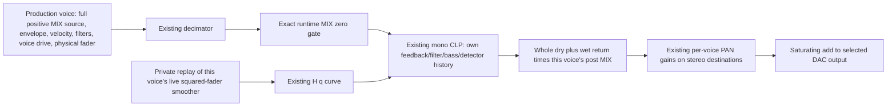

# R12: six independent mono CLP voice paths

Date: 2026-11-01 UTC. Repository: DocLXR-02/lxr-desktop-app.

## Outcome and authorization

**OFFLINE CANDIDATE VERIFIED within the stated test domain. Experimental; NOT CLEARED FOR DEVICE INSTALLATION.** All six synthesis/mixer paths can run independent mono CLP histories with their own post-MIX and physical-fader output control. There is one shared CLP parameter set and D/W. No voice-count cap, global normalization, filter repair, telemetry, extra UI or format change was introduced.

The owner explicitly approved execution of DRAFT v3, including implementation, focused tests/CI, one final Release ARM build and the proposed R12 IMG/ZIP identity. Installation, listening, SD update and hardware measurement were excluded and were not performed. Owner-tested R11 solo behavior under manually selected all-six-FILTER-OFF conditions is the reference; it is not R12 hardware evidence. Nothing is frozen or released.

| Identity | Exact value |
|---|---|
| Source base / preserved R11 | 64263ed25f2e9c7f5d880b493d943bfba29271a8 |
| Base source tree | ad5d81b94ede2af0ff776254e539c50be24c76e1 |
| New source branch | fx/clp-six-mono-r12-candidate |
| Candidate source commit | **ff47d945d283fd3def4af3aff974bdcafb69ffd3** |
| Candidate tree | c1f9bb2e6233f9516fe4b26386dcb39e72b10109 |
| Documentation context | docs/lab-project-state at bb7f4caa0da492b1426a47690059c2712de9c3e1 |
| Report branch | codex-reports/2026-11-01-six-voice-mono-clp-candidate |
| Report branch base | lab-setup, exactly 5829398cea5d337200393757e39a37d4d8148256 |
| CI | [41355689765](https://github.com/DocLXR-02/lxr-desktop-app/actions/runs/41355689765), attempt1, success |
| CI job | 124995110571; one Release firmware build |

Remote R11 head and its tree were verified before branching. No existing R12 implementation was found. There was no conflicting source revision and no documentation branch was used as firmware. Main, lab-setup, R4, R11 and all other existing remote heads are preserved; only the new source/report branches are added. No merge, force-push, release, setting change or device action occurred.

Private KnowledgeBase v1.4.0 was read and its supplied byte identity verified during preparation; it stays private and is excluded from source, CI and this report. Read the five pinned public status/workflow/evidence/recordkeeping/resource-ledger documents and source AGENTS.md. The current explicit owner decision supersedes the historical suggestion to prioritize filter repair/measurements first: this task is a six-path **offline** candidate, while target capacity gates remain UNMEASURED.

## Evidence reused and validation scope

Reused the [final R11 report](https://github.com/DocLXR-02/lxr-desktop-app/blob/84bc8a8c81fbc3d348c509ee5a2c7d5329d4cf8c/docs/codex-berichte/2026-10-31_r11-arithmetic-and-filter-off-post-mix.md), source tests/fx_clip_r11 and tests/fx_clip_r10, [R11 CI41214348060](https://github.com/DocLXR-02/lxr-desktop-app/actions/runs/41214348060), [MIX/VOL design](https://github.com/DocLXR-02/lxr-desktop-app/blob/ae39a8b5398da1ea36bcb0148d40c8ab8461d184/docs/codex-berichte/2026-10-31_clp-mix-vol-decoupling-design.md), [ARM arithmetic triage](https://github.com/DocLXR-02/lxr-desktop-app/blob/d0215ef5b090313ff31ce2ae0da88d72dd2100b2/docs/codex-berichte/2026-10-31_clp-source-arithmetic-arm-triage.md), and [resource audit/measurement design](https://github.com/DocLXR-02/lxr-desktop-app/blob/fa3c5b711733d022301669f0bdacd650cde5d6d9/docs/codex-berichte/2026-11-01_r11-resource-reliability-audit.md). The historical 39936-case audit, earlier long soaks and historical firmware builds were not repeated.

New tests are necessary for the changed per-voice eligibility, mono routing, private state, post-MIX, fader metadata, reset and summation paths. They use the actual six production voice generators, actual CLP and other effects, and verbatim extracted production mixer functions with deterministic hardware/control shims. R11 is the acoustic/behavioral comparison; isolated R12 mono instances are the exact state/return oracle. No equality between R12 independent histories and R11 stereo/shared histories is demanded.

Known inherited errors remain separately classified. Host CLZ-zero substitution, unsupported user-sample synthesis and control/scheduler limitations are explicit below. Full-engine boot, physical DMA/SD/USB behavior, actual morph/recall scheduling and device CPU/stack/thermal capacity are not established by these fixtures.

## Implementation and signal ordering

### Independent state, shared controls and code

[FX/Distortion.c](https://github.com/DocLXR-02/lxr-desktop-app/blob/ff47d945d283fd3def4af3aff974bdcafb69ffd3/Core/Src/Soundengine/DSPAudio/FX/Distortion.c) is **byte-identical to R11**. The existing mono branch is reused with channels=1; the nonlinear DSP is not copied six times. It already accepts interleaved input/output storage while reading/processing channel0 only. Its normalized input uses division by32768.f; for an int16 input this power-of-two conversion is exact before the double recurrence. The detector examines that original mono sample and a zero second channel, retaining threshold/441-frame hold/221-frame feedback fade. Unlike R11 stereo, another channel or voice cannot keep this instance's detector open.

[New SoloMix implementation](https://github.com/DocLXR-02/lxr-desktop-app/blob/ff47d945d283fd3def4af3aff974bdcafb69ffd3/Core/Src/Soundengine/SoloMix.c#L9) holds six complete MasterDistortion structs, each176 bytes, plus one reusable set of working buffers. The second channel of each full-size struct remains unused/zero; compacting it was not needed or attempted. The existing global FxBus distortion object remains for shared controls and other distortion algorithms; the six additional runtime contexts total1056 bytes. There are six active mono paths, not seven independent musical tracks or CPU cores. Open/closed hi-hat tracks retain their one shared synthesis path.

At block entry, after the existing modulation/async path and before synchronous voice advancement, selection is derived freshly from configured FX routes when FX type is distortion and mode CLP/RAT. Silent, muted and velocity-zero configured paths are not reclassified. Shared DRV/COL/TON/VOL, D/W and bus destination are snapshotted once into audio-owned controls. Each context receives those same values before processing. The existing tone/gain preparation inside the reused mono processor still runs per call; it was not refactored into a different numeric formula or coefficient policy.

Mutable filters, slew, lastOut, bass pole, idle count and feedback gain are per voice. Tables/code and the UI parameters are shared. Only audio rendering writes the new DSP histories. The existing renderer's foreground/TIM2 ownership assumptions remain; this is not a new whole-engine interrupt-serialization proof.

### Per-voice signal diagram

The following path applies independently to Drum1, Drum2, Drum3, Snare, Cymbal and the shared Hi-Hat. Their existing synthesis/filter/velocity/drive ordering is preserved, with the same R11 full-MIX source selection now available for every configured CLP path.

Inside M: driven input and unattenuated feedback pass through unchanged filters/slew/rails/diode/tone; lastOut remains internal. Only audible core is multiplied by H(q). The unchanged R7 bass branch is added outside lastOut/feedback, followed by unchanged D/W. Post MIX then scales **all** dry/core/bass together. No clean bass bypass or output normalization was added.

| Voice paths | Full-source/post-level ownership |
|---|---|
| Drum1/2/3 | Existing live MIX pole advances once/frame; actual output becomes post MIX. Full source retains actual physical-fader pole/envelope/velocity/voice drive. |
| Snare | Runtime block MIX target is post level; source uses1 for positive target. Existing finite clamp is used before voice distortion in both velocity branches whenever CLP-routed, including multiple routes. |
| Cymbal/Hi-Hat | Runtime block MIX targets become post levels; their existing downstream voice distortion, velocity/fader and envelope processing receive the R11-style full-MIX source. |

No global .vol target is overwritten to127 and no quantized source is divided by MIX. Runtime targets are resolved after modulation; a stored UI0 does not override deliberate runtime modulation that raises the effective target.

### Fader capture and curve

[mixer.c:551–571](https://github.com/DocLXR-02/lxr-desktop-app/blob/ff47d945d283fd3def4af3aff974bdcafb69ffd3/Core/Src/Soundengine/DSPAudio/mixer.c#L551) captures all actual live OnePoleFilter states and squared ADC targets before live synthesis advances them. [SoloMix.c:44–50,91–99](https://github.com/DocLXR-02/lxr-desktop-app/blob/ff47d945d283fd3def4af3aff974bdcafb69ffd3/Core/Src/Soundengine/SoloMix.c#L44) privately replays each configured voice's own captured pole with production calcOnePole and its original coefficient/cadence. These are overwritten block snapshots, not six added persistent smoothing trajectories. No live pole is advanced for metadata. The three drum live MIX poles and all six live fader poles are checked against independent replayed contents in integration tests.

[FxBus_clipCoreGain](https://github.com/DocLXR-02/lxr-desktop-app/blob/ff47d945d283fd3def4af3aff974bdcafb69ffd3/Core/Src/Soundengine/FxBus.c#L46) exposes the unchanged R9 mapping in ordinary flash:

    H(q) = 0                  q <= 0
           1                  q >= .25
           2*sqrt(q)          otherwise

At steady physical travel u, q=u². Core gain is1 for u>=.5, then2u below it. This is additional audible-core control only, never written into lastOut. R10's maximum-across-routes helper is not used for R12 CLP; the unused ordinary-flash helper is garbage-collected. A silent high-fader voice cannot hold another instance's audible core open. It can still hold its own output gain up while its own detector governs input inactivity.

### Exact zero and lifecycle

Effective target exactly0 selects zero new source and retains the post-decimator gate. The post gain is also exactly0, bypassing any remaining drum MIX release. Actual live smoothers still advance at their existing cadence. Configured CLP paths continue processing zero input, allowing their own detector/feedback/bass/filter states to settle internally. No ordinary MIX/fader movement resets a history, and positive near-zero MIX retains full excitation plus low post output. The zero endpoint can step; decimator-held history is preserved and can become visible on return if still frozen, as in R11.

Fresh route activation resets only that path lazily at its next audio processing entry. Deactivated paths are not rendered or mixed; their history is inaccessible while inactive and is cleared on re-arm, preventing an old feedback state from leaking into a newly activated path. This is an explicit route-transition policy, not dropping active tails to meet a voice-count/CPU cap. Still-configured silent/zero-MIX paths are not skipped.

FxBus_init and [FxBus_prepareFxChange](https://github.com/DocLXR-02/lxr-desktop-app/blob/ff47d945d283fd3def4af3aff974bdcafb69ffd3/Core/Src/Soundengine/FxBus.c#L188) advance an unsigned reset serial; control paths request a reset without writing per-voice histories. Audio consumes the serial at block start and re-arms selected contexts. Serial wrap UINT32_MAX→0 is tested. This assumes fewer than2^32 reset requests between observations and the existing control/audio ownership. Parameter changes alone do not reset histories. The actual reset endpoint used by kit/FX recall is tested; real SD/morph scheduler execution is not claimed.

Zero CLP routes produce no shared residual CLP output. For other effect types, distortion modes and direct routes, the original processing algorithms remain. Other effects' inherited tail/reset policies are not redesigned. Switching type or routing can step and carry intentionally different state/sound; no crossfade or immediate equivalence to prior shared-bus history is promised.

### PAN, output routing and headroom

Each voice is processed before PAN, then uses the same PAN gains the original mixer would have supplied. Stereo destinations0/1 receive the two scaled copies. Mono destinations2–5 receive the unpanned mono return, matching the existing single-output distribution convention; PAN does not choose or silence an explicit mono output. All six bus output destinations are tested. FX bus destinations remain explicit and do not acquire the unrelated direct-route jack-fallback behavior.

The whole int16 return is post-scaled, PAN-scaled where applicable, then added using int32 intermediate and signed16 saturation. Per addition, the sum is within[-65536,65534], so no int32 overflow is needed to saturate it. No six-voice source trim/limiter/AGC is introduced. Saturation occurs in existing voice order0–5, interleaved with direct contributions. This differs from R11's direct-voices-then-one-FX-return order and may change clipping/intermodulation/loudness. Multiple strong returns can clip; numeric boundedness is not proof of desirable sound or absence of clicks.

## Changes and preservation

Six production files change:

- Core/Src/Soundengine/SoloMix.c and Core/Inc/Soundengine/SoloMix.h: all-route CLP selection, private per-voice state, shared control/fader snapshots, reusable mono buffers, post-MIX/PAN/output accumulation and lifecycle.
- Core/Src/Soundengine/DSPAudio/mixer.c: capture helper, per-voice CLP dispatch before existing output distribution; obsolete shared gain buffer removed.
- Core/Src/Soundengine/FxBus.c and Core/Inc/Soundengine/FxBus.h: shared H mapping exposed; reset-request serial. Other FX DSP remains unchanged.
- Core/Src/main.c: only the string R11→R12. Normal startup is **LXR LAB R12**, blank second line. Clear/timing/bootloader-update messages and FIRMWARE_VERSION are unchanged.

The workflow .github/workflows/clp-r12-build.yml and eleven new files under tests/fx_clip_r12 provide isolated validation/build/package tooling. [changed-files.json](../evidence/2026-11-01-six-mono-clp/changed-files.json) lists all18 paths. Original R11/R10 tests/workflows are untouched. Their historical solo/shared-Maximum integration expectations are intentionally superseded only for CLP; unchanged numeric CLP tests are reused without weakening assertions.

DrumVoice.c, Snare.c, CymbalVoice.c, HiHat.c, Oscillator.c, transientGenerator.c, ResonantFilter.c, 1PoleLp.c, local voice distortion.c and all four FX DSP source files are byte-identical to R11. No kit/UI/storage/parameter-format change. Expanding SoloMix_isVoice eligibility lets the existing R11 snare calls use their approved finite saturation for multi-route CLP without editing the snare engine. Direct/non-CLP conversions retain their prior behavior and known failures.

## Actual validation and failures

Native local GCC14.2.0; CI Ubuntu GCC13.3.0. Cortex-M7 Release uses the same official Arm GNU14.3.Rel1 GCC14.3.1, build arm-14.174, archive SHA-256 **8f6903f8ceb084d9227b9ef991490413014d991874a1e34074443c2a72b14dbd** as R11. All122 production compile commands match the recorded R11 commands after compiler-path normalization; no global optimization, linker, placement or diagnostic flag change.

Host builds use O2 and an additional O3/fast-math variant, -fno-strict-aliasing, ASan/UBSan/bounds/float-cast-overflow with nonrecovering diagnostics. Explicit exponent-bit checks validate CLP finiteness. LeakSanitizer is not exercised (detect_leaks=0); the harness is not an allocator/device-memory-growth test. Production configuration macros, REAL_FS44140.0 and 64-frame cadence are checked against source. Target instruction behavior and native FP results are not universally identical.

| Executed check | Actual outcome |
|---|---|
| Source scope | Six production paths only; unchanged DSP/voice/filter/other-FX bytes; splash-only main change |
| Main integration | **1476 passed**, including six actual voice paths/both velocity modes, MIX0/1/5/10/20/50/127, selected sine/transient/FM/PWM sources, D/W endpoints/intermediate, full/moving/zero faders, all64 masks/six destinations, unequal six-voice mixtures, direct voice isolation, runtime MIX automation/modulation injection, sparse/returning notes and FX/reset transitions |
| Independent state/return | Every processed voice/block compared with isolated production mono DSP state using identical incoming samples, controls and replayed fader. Complete MasterDistortion memcmp, isolated return, live fader pole and post-MIX/PAN/saturating arithmetic checked separately. Positive fixed MIX changes only post output, not the tested excitation/state/return. |
| Expanded snare boundary | **2088 clamp calls in180 CI cases**, sole and multiple CLP routes, both velocity branches. Production helper preserves finite defined-domain results and saturates near/over-range examples34647/52787. No NaN policy added. |
| Existing outside-CLP behavior | **192 exact R11/R12 output pairs pass**, actual OFF/tube/fold/Ringmod/Compressor/Delay paths; Delay restricted to stereo, Compressor at its initialized makeup. Direct paths remain unchanged. |
| Moderate filters | Four selected R11/R12 drum/snare LP integration cases pass. Not a filter-stability matrix or repair. |
| Components | 960 type/mode/route combinations; actual H table/100001-point bounds/monotonicity, finite snare boundary checks; all-six mono output/state consistency at1/7/64 frames; reset/re-arm/serial-wrap; shared-control snapshot remains coherent if global controls change afterward |
| Idle | All six max-regeneration mono paths are excited, then process zero; later output blocks are quantized zero with feedback gain0. Exact target-zero/frozen-decimator integration also mutes without injecting held samples. |
| Unchanged CLP numeric regressions | Original CLP unit, R7 state and R8 state assertions pass against unchanged production Distortion.c |
| Existing regressions | BUG001, kit-load, project-storage and Euclidean suites pass unchanged |
| Synthetic paired renders | **20 R11/R12 pairs /40 four-channel WAVs**, see below; no acoustic-equivalence claim |
| Release / image / stack sidecars | One Release build succeeds; eight compile-only .su sidecars have executable sections identical to original build objects; no second firmware link |

The initial local1356-case matrix passed; focused additions for live MIX ownership/PAN, velocity-zero/automation and FM/PWM/shared control trajectories expanded it through1404 to1476 cases. These corrective **coverage additions**, rather than unexplained build retries, justify the local reruns. CI repeats the final bounded matrix on the pinned source before its single ARM build. No new unexpected sanitizer failure or test failure occurred. Git's default whitespace check initially treated preserved CRLF endings as whitespace; the explicit cr-at-eol check passes without whole-file reformatting.

**Expected inherited failures remain failures:** six isolated original/non-CLP snare over-range cases fail float-to-int16 conversion in both baseline and candidate, with raw stderr retained. No/multiple routes to ordinary non-CLP/direct paths are not silently saturated. Previously established resonant-filter instability is unchanged and not rerun for a larger case count. CLZ(0) during complete FX initialization is still a production source issue; the native fixture explicitly returns32 for zero, matching the documented ARM instruction convention, and uses builtin CLZ otherwise. This is a host substitution, not a production fix or untouched-source sanitizer pass. Delay mono-right, higher-makeup Compressor mono, USB ownership and long-uptime scheduling findings are unchanged and not relabeled as passed device tests.

Coverage limitations: deterministic HAL/ADC/RNG services, runtime modulation target injection and synthetic note-event/mute/gap patterns replace actual hardware/control scheduling. Real voices/async/sync/mixer/decimation/pan/CLP execute, but not full firmware boot, the real MIDI/LFO/morph dispatcher, SD recall or DMA interrupts. User-sample synthesis aborts in the inherited fixture and is not covered. Earlier broad R11 source tests are reused as historical evidence, not claimed as a new all-parameter or complete-engine run. Moderate filter tests do not remove the existing manually FILTER-OFF listening boundary or turn filters off automatically.

### Paired audio findings

WAVs are synthetic production-path renders at44140Hz, four channels in order DAC1 L/R, DAC2 L/R. Included solo drum/snare/hat at MIX5/20/127, full/moving fader with returning notes, and two unequal six-voice mixtures. They are in the separate CI evidence artifact, not device recordings. Render commands, per-channel RMS, exact-channel checks and differences are retained in [r12-renders-results.json](../evidence/2026-11-01-six-mono-clp/r12-renders-results.json).

A revealing max-regeneration hard-left drum case at MIX127 has R11 channel RMS approximately[20934.85,20982.81,0,0] LSB, R12[20934.85,0,0,0]. The left channel is sample-identical. R11's linked stereo detector can let the unexcited right-side core regenerate while left input is active; R12 has one mono history and pans its whole return afterward, so that independent opposite-side tone is absent. Hard-right hat shows the corresponding exact right channel and newly silent left. This is an architectural change, not an accidental promise of stereo equivalence.

At intermediate PAN, input reaches the new core unpanned/full relative to MIX, so its drive/feedback balance can differ from either old attenuated stereo input. Mono stereo pairs are also correlated rather than separately regenerating. The20 whole-output difference RMS values range350.77–15357.67 LSB; those numbers do not establish preference. Six-voice mixtures reach the int16 rail, with sample steps up to65535. No strict total-RMS monotonicity, click-free or live-safe claim is made. Owner comparison of timbre, PAN, fade, bass and summed headroom remains pending.

## Resources and generated work

Same target compiler/flags; values in bytes. R11 numbers use the existing delivered ELF/map and audit, not a new baseline rebuild.

| Resource | R11 | R12 | Delta |
|---|---:|---:|---:|
| ITCM /16384 | 15560 | **15976** | +416 |
| ITCM remaining | 824 | **408** | -416 |
| DTCM static extent /131072 | 108184 | **109640** | +1456 |
| Static DTCM gap to runtime SP | 22888 | **21432** | -1456 |
| SRAM .data+.bss sum | 274144 | 274164 | +20 |
| Aligned SRAM static extent | 274144 | **274168** | +24 |
| Printed RAM incl512-byte heap reservation | 274656 | **274680** | +24 |
| Printed linker FLASH | 238768 | **239316** | +548 |
| Full flash load payload | 291324 | **292288** | +964 |
| Image file incl16-byte header | 291340 | **292304** | +964 |
| Physical app-flash span remaining | 724484 | **723520** | -964 |

R12 .data852 + .bss273312 =274164, with four extra bytes before BSS giving aligned extent274168. Heap reservation is additional, not DTCM stack. Initial vector SP remains0x20080000, but actual Reset_Handler loads0x20020000; the21432-byte gap is **not a measured safe stack margin**. The nominal512-byte heap reservation is not a full heap-use bound.

New SoloMix DTCM storage totals2224: paths1056, targets/fader targets48, replayed OnePole copies96, postMix256, core gain256, interleaved input256 and isolated output256. Compared with R11 SoloMix512 plus mixer gain256, delta is1456. Shared controls/reset/selection metadata accounts for general-SRAM changes/alignment. Arrays are reused sequentially per voice; no six scratch-buffer copies, heap allocation or new live smoother. The old global FxBus object376 and global Delay history65536 remain unchanged.

The mixer symbol grows3400→3806 ITCM bytes (+406); ITCM veneers544→552 (+8), with remaining alignment accounting for +416 section growth. No existing routine was moved or optimizer flag changed to conceal a fit issue. New helpers stay in ordinary application flash. Distortion_processWithClipGain remains6132 code bytes, not six cloned functions. Source's old maximum helper is no longer retained in the target ELF; its412 ordinary-flash bytes disappear as a direct consequence of removing that policy. The unused legacy FxBus_process wrapper remains384 ITCM bytes; no separate optimization was bundled or savings assumed.

Relevant own compiler frames: mixer488→496 (+8); new SoloMix_addVoice96; begin24; old solo process64 becomes the small end-of-block dispatch. Distortion remains184. The old max-replay168 frame is not on the R12 active CLP call path. Six calls are sequential, so do not multiply a local frame by six as concurrent stack. Callers, arguments, other voice VLAs, library routines, interrupts and FPU context still prevent a whole-engine bound. Eight -fstack-usage compile-only sidecars have identical executable sections to their actual build objects; this produces analysis evidence without a second Release link.

The delivered H function at0x0802684c has bounded comparisons, VSQRT.F32 only in the interior region, then doubling. Its own stack frame is0. The mixer contains six calls to SoloMix_addVoice through an ITCM veneer. At full routing, six64-frame mono CLP calls mean384 mono frame updates, compared with the old shared64-frame stereo call's128 channel updates. That roughly triples the channel recurrence count, **not the whole-engine CPU load**; it also repeats per-call setup/mixing. Each configured voice privately replays its fader and maps H; worst case six low faders can require384 square roots versus the old shared curve's64. Above the knee the square-root branch is skipped. These are code/work counts, not measured M7 utilization, latency or deadlines.

## Build/package verification and delivery

One Release build, CI41355689765, attempt1, succeeds using the checked established toolchain archive. No local ARM firmware build or second firmware link. Post-build .su objects are analysis-only and not part of the image. Runtime diagnostics remain compiled OFF; no diagnostic symbols/UI/device readout or equipment is assumed.

Independent downloaded-byte verification checked both GitHub wrapper SHA-256 values, all52 internal manifest files, all444 source archive blobs plus exact archive membership against candidate Git tree, source commit/archive comment, image/ELF contents and ZIP membership. Header magic LXRV2IMG, payload292288, internal additive checksum **0xa3**, reserved bytes000000. All126 vectors/115 nonzero handlers pass code-range/Thumb checks; vector reset0x08013555. Startup label matches R12 and contains no obsolete second-line product string. Clear/splash/update timing is preserved by the source-only string change.

Contiguous file-backed ELF load intervals, all application-only:

| Start | Exclusive end | Bytes |
|---|---|---:|
| 0x08008000 | 0x08042380 | 238464 |
| 0x08042380 | 0x080426d4 | 852 |
| 0x080426d4 | 0x0804b758 | 36996 |
| 0x0804b758 | 0x0804f5c0 | 15976 |

Every loaded byte matches the image payload. Full payload =239316 printed FLASH +36996 DTCM load +15976 ITCM load =292288; initialized run regions are not omitted or double-counted.

| File | Bytes | SHA-256 |
|---|---:|---|
| **LXR_V2_R12.img** | **292304** | **ceab081c7a4e02f4fdb6e261b8cf4477ea01e950433aa150ca73455a5458e1e4** |
| **LXR_V2_R12.zip** | **208365** | **f1883b6bc70ee938dbd9db671a42218e028477b4b3583ea28e0da96fa97460cc** |
| LXR_V2_STM32F765.elf | 398512 | 39f33bd654869dc52796b03225af47230b1cc2e0400d30cedf846a20fd03f628 |
| LXR_V2_STM32F765.map | 544950 | beacf4b037d5b73497991c2246f055e7e57aa56750865198662f9c4871bdb552 |
| SOURCE.zip | 1807053 | 513f2cd2bd9b6eede64dc333e9a703f0e050b297499ef643d87d66e8c81b1852 |
| HOST_RESULTS.tar.gz | 2230518 | 3bd3127c2816fabb75b28342c80afdbd1912c4dbea3e49556dc8fa051f275dd3 |

**LXR_V2_R12.zip contains exactly one top-level LXR_V2_R12.img.** GitHub's outer artifact download wrapper contains that ZIP and the separate image; it is not the owner firmware ZIP itself. No rename/patch of an old binary was used.

- [Offline candidate artifact13103162036](https://github.com/DocLXR-02/lxr-desktop-app/actions/runs/41355689765/artifacts/13103162036), outer wrapper423664 B, SHA-256 ba0c338a32cbdf25b163a423cd0a91b91dac64b92758f725c8a4daf232d72a69.
- [Separate complete source/build evidence13103142005](https://github.com/DocLXR-02/lxr-desktop-app/actions/runs/41355689765/artifacts/13103142005), wrapper4817472 B, SHA-256 67cefeab0042246b9d455c89543248a3ea2c9edf0842c0f1f742649e1dfa5fa8.

Both downloaded wrapper hashes match live GitHub metadata; downloaded inner IMG/ZIP bytes match the published manifest. Artifact retention is90days, expiry2027-01-30T22:09:35Z. Large binary/source archive/ELF/map/WAV bundles are **not mirrored permanently into Git**; availability after expiry is NOT ARCHIVED unless retained elsewhere by the owner. Compact primary logs/results and verification scripts below are durable Git evidence. Do not imply a Library upload occurred.

## Reproduction, recordkeeping and remaining gates

From the candidate source root, native GCC/Python3.12+/NumPy2.3.5:

    python3 tests/fx_clip_r12/scope.py
    python3 tests/fx_clip_r12/component.py
    python3 tests/fx_clip_r12/run.py
    python3 tests/fx_clip_r12/regressions.py
    python3 tests/fx_clip_r12/renders.py
    python3 tests/bug001/run.py
    python3 tests/kit_load/run.py
    python3 tests/project_storage/run.py
    python3 tests/euclidean/run.py

Executed CI then runs cmake --preset release and cmake --build --preset release --parallel 2, followed by package.py and stack.py. Exact commands, versions, raw expected-failure stderr, successful aggregate/per-case results and compiler commands are retained under [docs/evidence/2026-11-01-six-mono-clp](../evidence/2026-11-01-six-mono-clp/README.md), with SHA256SUMS. The committed test drivers reproduce the workload; the downloaded SOURCE.zip pins all code. New important raw evidence is not left only as a local path/hash. Historical R11 audit retention gaps remain historical; no redundant rerun or claim of closing them is made. The central docs/lab-project-state index/status is unchanged under this bounded task; this new report is not yet indexed there.

To independently check downloaded artifacts without rebuilding, use the companion verify_downloads.py with --repo, --evidence, --image and --output paths and pyelftools0.32. Its output is [download-verification.json](../evidence/2026-11-01-six-mono-clp/download-verification.json). Source/report branches and published compact evidence bytes are checked remotely; no existing head is modified.

| Final gate | Result |
|---|---|
| Six independent mono paths / source ownership | Verified in the stated production-path host matrix |
| Scoped software tests and one CI/Release build | PASS; known inherited failures remain explicitly failed/excluded |
| Image/ELF/source/package provenance | PASS, independently checked after download |
| Static fit | PASS, only408 ITCM bytes remain |
| Musical acceptance / mono-PAN and inter-voice sound | PENDING owner comparison; no R12 device recording/listening |
| Actual CPU/IRQ/DMA deadlines and buffer freshness | **UNMEASURED** |
| Actual stack high-water, temperature and sustained performance | **UNMEASURED** |
| Device installation/listening authorization | **NOT GRANTED by this task** |

The owner currently has no debugger, oscilloscope/logic analyzer or installed telemetry/custom diagnostic UI. This task neither requests nonexistent logs nor implements such equipment/readout. No numeric reserve or actual safe instance count is inferred from memory fit, native timing, instruction counts or successful CI.

The remaining sound questions are whether independent sources retain the desired bass/scream balance across MIX and physical fader movement, how post-mono PAN/removed opposite-side regeneration compares with R11, how six summed returns clip, and whether zero/return/type/route transitions are musically acceptable. Those questions and all target-performance gates remain for a separate owner decision. This report completes the authorized offline task; no unsolicited next implementation task or hardware instructions are issued.
